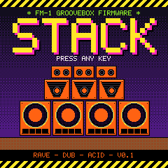
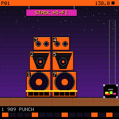

# STACK

 

**ES** · Firmware open-source para el **M-VAVE FM-1** que lo convierte en una groovebox de 8 pistas para rave, dub y
acid. Cada pista que añades trae una caja de altavoz al *sound system* en pantalla: subs abajo, medios en medio, tops
arriba.

**EN** · Open-source firmware for the **M-VAVE FM-1** that turns it into an 8-track groovebox for rave, dub and acid.
Every track you add brings a speaker cabinet to the on-screen sound system: subs at the bottom, mids in the middle,
tops on top.

> ⚠️ **Beta / pre-alfa — instálalo bajo tu responsabilidad. Install at your own risk.**
> Estado: **Fase 3**: secuenciador de 8 pistas, percusión analógica modelada, bajo acid 303 y el sound system animado
> que se construye con el patrón.
> Status: **Phase 3**: 8-track sequencer, modelled analogue drums, a 303-style acid bass and the animated sound system
> that builds itself from the pattern.

Plan y hardware: [docs/PLAN.md](docs/PLAN.md) · [docs/HARDWARE.md](docs/HARDWARE.md)

## Probar sin hardware · Try it without hardware

```bash
make web && make serve      # http://localhost:8017/  (Emscripten 6.0.10, Python ≥ 3.10 + Pillow)
```

In the emulator: click **Switch on**, press any key to leave the flyer: the demo's speakers drop onto the stage.
**PLAY** runs it; the cones push with every hit.
Knobs: drag or mouse wheel. Shift-click or right-click holds a key or button down (to hold a step and turn knobs).

| Control | Does |
|---|---|
| White keys | the 16 steps of the page: tap on/off; **hold + knobs** edits the step (NOTE VEL GATE PROB; ALGO → RATCHET NUDGE COND ACC/SLD) |
| Black keys 1–8 | sequencer: pick the track · sound system: mute (HOME+key: solo) |
| Black keys 9 / 10 / 11 | PAGE / FILL (held) / KEYS mode (play the track chromatically; SEQ returns) |
| PLAY · REC | play-stop · arm live recording (KEYS mode, quantised) |
| SEQ · EDIT · ENV · GLO | sequencer · sound pages (EDIT again or ALGO: next page) · decay page · tempo, swing (ALGO: scanlines) |
| HOME tap · HOME held | the sound system · SHIFT: +SEQ copy, +EDIT paste, +REC clear, +SAVE undo, +PLAY demo, +GLO help, +FX I/O test |
| SELECT · PRESET · K1–K4 | track · sound preset · the page's parameters |
| OCT− / OCT+ | page (KEYS mode: octave) |

```bash
make test                   # unit tests (core/ui) + the app in fm1-base's host simulator (PNG, WAV, checks)
```

## Seguridad del hardware · Hardware safety

STACK never touches the FM-1's bootloader or the update loader: both come unmodified from
[felucca-bsp](https://github.com/hugelton/felucca-bsp) through [fm1-base](https://github.com/charlesvestal/fm1-base).

If something goes wrong / Si algo falla:
1. **Hold REC while switching on**: the FM-1 enters the chip's update mode; reinstall any firmware from Chrome/Edge
   (fm1-base, `base/device/main_fm1.c`).
2. Two failed starts in a row put STACK in **safe mode** (USB on, no audio) so an update can still reach it.
3. Back to the official firmware: install M-VAVE's V15 (`FM-1_015.fwsc`) the same way, or use
   [thefirmwarehub.com/tools/rescue](https://thefirmwarehub.com/tools/rescue/).

Note: the OCT− power-on rescue described for other firmwares is not part of fm1-base; use REC (see docs/PLAN.md, R6).

## Build

| Command | What |
|---|---|
| `make test` | unit tests + host simulator |
| `make web` / `make serve` | browser emulator |
| `./build.sh` | FM-1 package `app/build/stack.fwsc` (JieLi toolchain + AC79 SDK; CI does it: `.github/workflows/release.yml`) |

## Licencia · Licence

GPL-3.0-or-later ([LICENSE](LICENSE)). Built on fm1-base and felucca-bsp (MPL-2.0): see [THIRD_PARTY.md](THIRD_PARTY.md).
Not affiliated with M-VAVE. No real sound-system names or logos are used.
