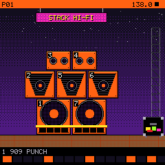
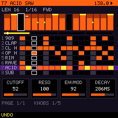
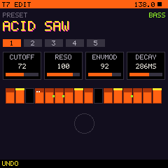
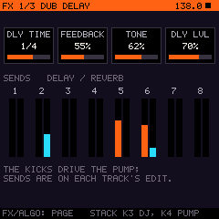
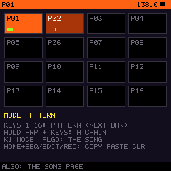

# STACK manual

STACK turns the M-VAVE FM-1 into an eight-track groovebox. This manual covers the screens, the controls, the sounds,
patterns and songs, saving, MIDI, and what to do if something goes wrong. It is **beta** firmware: install it at your
own risk.

## Quick start

1. Switch on. The flyer shows; press any key.
2. You're on the **sound system**: the demo's speakers stand on the stage. Press **PLAY**.
3. Press **SEQ** to see the steps. White keys turn steps on and off; black keys 1–8 pick the track.
4. Hold **HOME** and press **PLAY**: a demo builds itself up, a track every two bars. Press again for the next demo
   (RAVE 138, DUB 140, GABBER 180).

## The sound system

Every track with at least one step on brings a cabinet. Its category picks the row: **SUB** at the bottom (kicks,
basses), **MID** in the middle (snares, claps, leads, keys, pads), **TOP** on top (hats, shakers, cymbals, bright
FX). A track's category comes from its sound and can be changed on its EDIT page (CAT). A new cabinet drops in;
an emptied track's cabinet lifts away. Cones push with every hit, harder with velocity and accent.

| Control | Here |
|---|---|
| Black keys 1–8 | mute a track (its cabinet goes grey) |
| HOME held + black key | solo (the others go dark) |
| White keys | the selected track's steps (shown at the bottom) |
| K1 · K2 · K3 · K4 | tempo · swing · DJ filter (left low-pass, right high-pass) · pump |
| SELECT | pick the track (its cabinet blinks) |

The header shows the pattern (P01; "P01>P03" when P03 is cued; CHAIN or SONG), the tempo and play/record.

## The sequencer (SEQ)

The big row is the selected track's sixteen steps on this page; below, every track at a glance. Yellow tops mean
accent, a green dot slide, a dotted fill a probability under 100 %, white ticks ratchets, a magenta dot a condition,
a white corner parameter locks.

| Control | Does |
|---|---|
| White key (tap) | step on / off |
| White key held + K1–K4 | NOTE, VELOCITY, GATE, PROBABILITY of that step |
| … + ALGO, then K1–K4 | RATCHET (1–4 hits), NUDGE (early / late), CONDITION, ACCENT / SLIDE |
| LFO + white key held + K1–K4 | **parameter locks**: that step's own values for the EDIT page's parameters |
| LFO + white key held + REC | clear that step's locks |
| Black keys 1–8 | pick the track |
| Black key 9 · OCT− / OCT+ | next page (tracks have up to 64 steps) |
| Black key 10 (held) | FILL: steps with the FILL condition play |
| Black key 11 | KEYS mode: every key plays the track; SEQ goes back |
| PLAY · REC | play / stop · arm live recording (KEYS mode notes land on the nearest step) |

Conditions: FILL, !FILL, 1ST (first time round), !1ST, and A:B (play the A-th time in every B loops, e.g. 1:2, 3:4).
Each track has its own length (1–64), step size (1/32 to 1/4, triplets) and direction (forward, reverse, ping-pong,
random): set them on its EDIT page's last page.

## Sounds (EDIT)

**PRESET** turns through 36 sounds in six groups: DRUMS (808, 909 and gabber kicks, snare, clap, hats, rim, tom,
cowbell, shaker, ride, crash), BASS (acid saw and square, sub, reese, FM bass), LEAD (hoover, rave stab, square lead,
pluck, acid lead), KEYS (e-piano, FM bell, mallet), PAD (warm pad, strings, chord memory), FX (riser, downlifter, dub
siren, laser, sweep, impact, vinyl). **EDIT** (again, or ALGO) moves through the track's pages of four knobs;
**ENV** jumps to the first. The last pages hold LEVEL, PAN, the delay and reverb SENDS, the category, and the
track's length, step size, direction and MIDI channel.

**Chords.** Synth tracks have a CHORD setting: off, a chord from the list, or MEMORY. To store your own: KEYS mode,
hold the notes, press **LFO**.

## Effects (FX)

**FX** (again, or ALGO) moves through three pages: the **dub delay** (time in 16ths, feedback, tone, level; echoes
bounce left and right), the **reverb** (size, damping, level), and **pump** (the kicks duck everything else),
**compressor** and **DJ filter**. Each track's sends are on its EDIT page.

## Patterns, chains, songs (ARP)

Sixteen patterns share the eight tracks' sounds. **ARP** shows them: a white key picks one (stopped: at once;
playing: at the end of the bar). **Hold ARP and press patterns in order** to make a chain. **K1** sets the play mode:
PATTERN, CHAIN or SONG. **ALGO** turns to the song: K1 the row, K2 its pattern, K3 its repeats, K4 the song's length.
A song stops at its end. HOME held + SEQ / EDIT / REC copies, pastes or clears the whole pattern.

## Scale (SEL)

K1 the tonic, K2 the scale (chromatic, major, minor, dorian, phrygian, mixolydian, harmonic minor, minor and major
pentatonic, blues). KEYS mode and the step NOTE knob keep to it.

## Global (GLO)

Page 1: tempo, swing, fine tempo, the probability seed (the same seed plays the same "random" steps every time), and
the CPU load. Page 2 (ALGO): scanlines on the sound system, MIDI clock out, follow an external clock, start/stop
(send, obey, both). **HOME held + GLO** shows the help screen.

## Saving

**SAVE** saves the project (every pattern, the sounds, the song, the settings) to the FM-1's memory. Stop first: a
memory write pauses the sound for a moment. SAVE lights up while something is unsaved. The project loads when you
switch on.

**HOME held + SAVE** undoes the last track edit (copy, paste, clear). HOME held + SEQ / EDIT / REC copies, pastes,
clears a track.

**Back up** the project to a file, and restore it, with the [backup page](../backup/) (Chrome or Edge, USB). The same
files load in the browser emulator.

## MIDI (USB)

Give a track a MIDI channel (EDIT, last page, CH): its steps go out as notes on that channel, and notes coming in on
it play the track (and record, with REC armed). GLOBAL page 2 sends the clock (24 a quarter note), follows an
external clock (the header shows EXT and its tempo) and sends or obeys start and stop.

## If the CPU runs short

If a heavy pattern ever takes more time than the FM-1 has, STACK eases off by itself, a step at a time: three saws
instead of five in the supersaws, two voices a track, the reverb paused. GLOBAL shows the step (GUARD 1–3). Eight
quiet seconds bring each step back.

## If something goes wrong

- **Hold REC while switching on**: the chip's update mode. Reinstall STACK, another firmware or M-VAVE's own from
  Chrome or Edge.
- Two failed starts in a row bring up **safe mode** (USB on, no sound), so an update can still reach the FM-1.
- Back to M-VAVE's firmware: install its official package the same way.

STACK is GPL-3.0-or-later, built on fm1-base and felucca-bsp (MPL-2.0). Not affiliated with M-VAVE.
