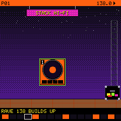

# STACK

A groovebox firmware for the M-VAVE FM-1, for rave, dub and acid. Eight tracks, sixteen patterns, 36 sounds made
from scratch (drums, basses, leads, FM keys, chord pads, effects), a dub delay, a reverb and a pump. Every track you
give a step brings a speaker cabinet to the sound system on the screen: subs at the bottom, mids in the middle, tops
on top. Each cone pushes with every hit.

This is version {{VERSION}}, a **beta**. You install it at your own risk; the installer can put M-VAVE's own firmware
back, and holding REC while you switch the FM-1 on opens the chip's update mode if anything goes wrong.

- [Try it in the browser](emu/). It runs the same code as the FM-1, with sound. Switch it on, press any key, then
  PLAY. HOME held + PLAY builds a demo up track by track.
- Demo projects to load (in the browser: "put a backup back"; on an FM-1: the [backup page](backup/)):
  [RAVE 138](demos/stack-demo-rave138.stk), [DUB 140](demos/stack-demo-dub140.stk),
  [GABBER 180](demos/stack-demo-gabber180.stk).
- [Install](install/) it from Chrome or Edge, with the FM-1 connected by USB.
- The [Manual](manual/) explains the screens, the controls, saving and MIDI.
- [Download {{PKG}}](firmware/{{PKG}}) for the command-line installer: `python3 tools/fm1_install.py {{PKG}}`.
- [Back up and restore](backup/) your project over USB.

**ES** · Firmware groovebox para el M-VAVE FM-1: 8 pistas, 16 patrones, 36 sonidos sintetizados, delay dub, reverb y
pump; cada pista con pasos añade una caja al sound system de la pantalla. Versión beta: instálalo bajo tu
responsabilidad (REC al encender abre el modo de actualización si algo falla). [Pruébalo en el navegador](emu/).

GPL-3.0-or-later. Built on fm1-base and felucca-bsp (MPL-2.0), which come from Felucca by Leo Kuroshita, Hügelton
Instruments. M-VAVE and FM-1 are trademarks of their owners; STACK is not affiliated with M-VAVE.
